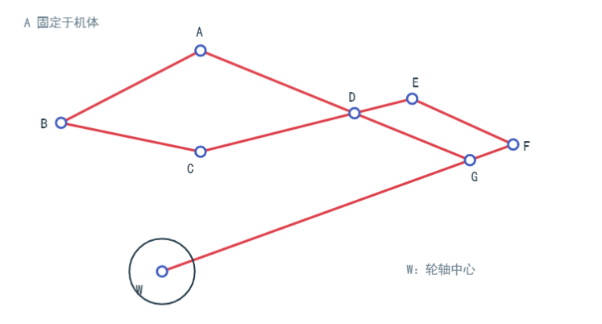

# 底盘电机 ID 布局

俯视图，车头朝上；从右上角开始，顺时针依次为 ID 1、ID 2、ID 3、ID 4。

```text
                  车头
                   ^
                电 | 池
      ID 4 (O)-----------(O) ID 1
           |             |
           |             |
           |             |
      ID 3 (O)-----------(O) ID 2
```

## 轮腿侧面五连杆示意

以下为单侧轮腿机构的侧视图，点位标号沿用提供的原图。



| 标记 | 含义 |
| --- | --- |
| A | 固定于机体的连接点。 |
| B、C、D、E、F、G | 图中的连杆连接点，后续描述沿用这些标号。 |
| W | 轮轴中心；图中的圆表示车轮。 |

按图中线段记录连接关系：

```text
A -- B -- C -- D -- A
D -- E -- F -- G -- D
G -- W
```

其中 `G-W` 连接至轮轴中心。以上只记录图中的点位和连接关系；杆长、关节零角及正方向不由图片比例推定。
